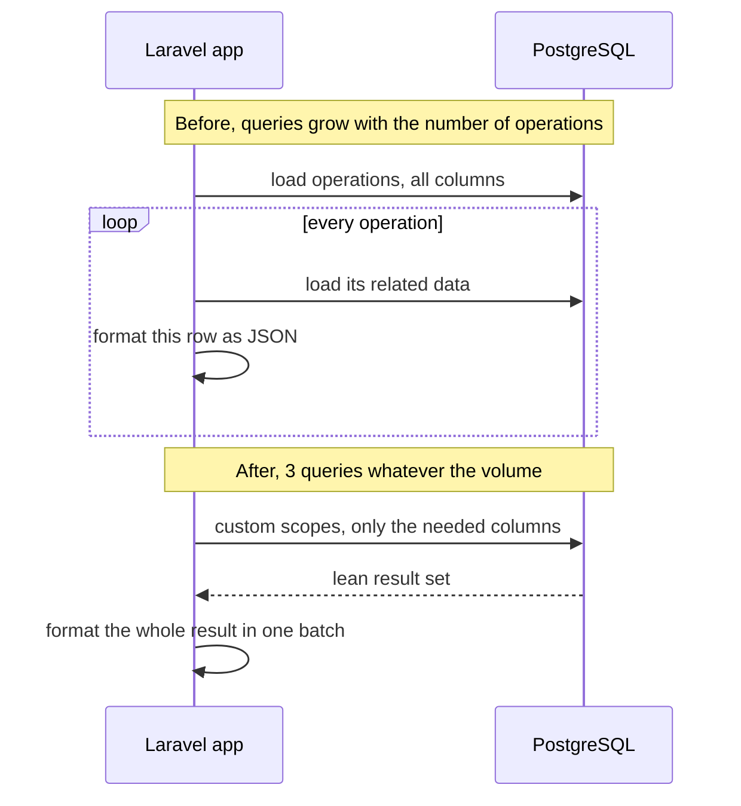

## The problem

A back-office export of crypto transactions for a group of users took **14–17 s** and regularly hit timeouts. It was an API endpoint returning JSON, used by internal teams, so a timeout meant someone retrying, waiting, and retrying again.

The export got slower as activity grew: the more operations users had in the selected period (a month or a year), the longer it took. That pattern is the first clue.

## Root cause: a query count that grows with the data

Three things stacked up:

1. **N+1 queries.** Related data was fetched per operation inside a loop, so the number of queries grew with the number of operations in the period.
2. **Over-fetching.** Every column of every row was loaded and hydrated into Eloquent models, even though the export only used a handful of fields.
3. **Per-row formatting.** The JSON was built operation by operation, adding work on every iteration.

Each query on its own was fast. The cost was the **round trips** and the work repeated per row: network latency, query parsing, hydrating full models, formatting. Total time grew linearly with the number of operations.



## The fix

- **Custom query scopes.** The export's query logic moved into dedicated Eloquent scopes that fetch everything in a fixed number of set-based queries instead of one per operation.
- **Only the columns the export needs.** Less data read, transferred and hydrated per row.
- **Batch formatting of the JSON response.** The result set is transformed in one pass instead of row by row.

A simplified illustration of the pattern (names and exact queries simplified, not the production code):

```php
// Before: everything loaded, relations fetched per operation, formatted row by row
$operations = Operation::whereIn('user_id', $userIds)
    ->whereBetween('created_at', [$from, $to])
    ->get(); // every column

return $operations->map(fn ($operation) => [
    'id'     => $operation->id,
    'asset'  => $operation->asset->symbol, // one query per operation
    'amount' => $operation->amount,
    // ...
]);

// After: a scope that selects only what the export needs
public function scopeForExport(Builder $query, array $userIds, $from, $to): Builder
{
    return $query
        ->select(['id', 'user_id', 'asset_id', 'amount', 'created_at'])
        ->with('asset:id,symbol')
        ->whereIn('user_id', $userIds)
        ->whereBetween('created_at', [$from, $to]);
}

$operations = Operation::forExport($userIds, $from, $to)->get();

return response()->json(ExportFormatter::format($operations)); // one pass over the set
```

Result: **3 queries in total, under 300 ms**, regardless of how many operations users had in the period.

## How it was measured

- **Development** against a **production dump**, so the data volume and distribution were real. N+1 problems hide on small dev datasets: with 20 rows, 20 queries feel instant.
- **Pre-production**, then **production**, with **Sentry** used to confirm the timings on the real path, not just on my machine.

## Same playbook elsewhere

The same approach (find where time is really spent, cut round trips, stop doing per-row work you can do once) also applied to scheduled jobs:

- A crypto-rewards job: **25 → 7 min**, memory **500 → ~300 MB**, via SQL optimization, buffered logging, and moving mailing off the synchronous path.
- An interest cron: **8 → 2 min**.

## Takeaway

The expensive part was not the computation. It was going back to a slower layer over and over, and carrying more data than needed. It's the same lesson as the [CPU memory hierarchy](/blog/cpu-memory-hierarchy): an L1 hit costs ~4 cycles and a trip to RAM costs ~250. Batch the trips, fetch only what you use, and measure on realistic volumes.
