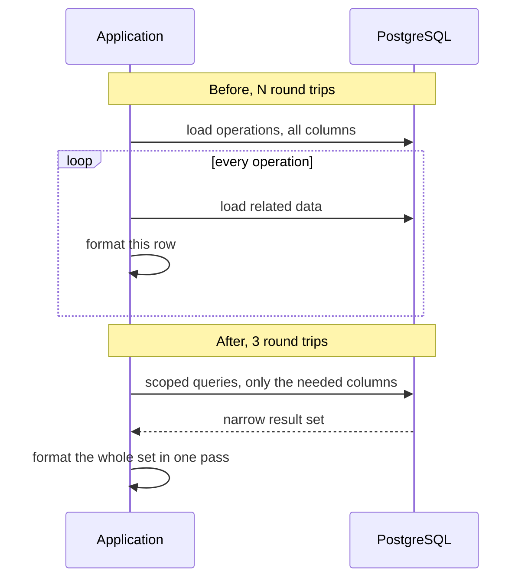

## Summary

A crypto-transaction export took **14–17 s** and regularly timed out. The time was not going into computation. It was going into **data movement**: round trips to the database that grew linearly with user activity, rows carried at full width when a few columns were used, and per-row work repeated N times.

Changing the cost model, from O(N) round trips to a constant 3, brought it **under 300 ms (~50×)**, independent of volume.

The stack was PHP/Laravel and PostgreSQL, but the reasoning is the same one that governs cache misses in C++.

## The setup

An API endpoint returned, as JSON, the crypto transactions of a group of users over a period (a month or a year). Internal teams used it, so a timeout meant someone retrying, waiting, and retrying again.

The latency got worse as activity grew. A cost that scales with the data is the first clue to look at the shape of the work, not its speed.

## The cost model

Before, the endpoint went back to the database once per operation, and did a full round of work per row:

```text
before:  T(N) ≈ N × (round trip + query parse + row hydration + formatting)
         → round trips grow linearly with the number of operations

after:   T(N) ≈ 3 × round trip + N × (small per-row cost, narrow rows, one pass)
         → round trips are constant
```

For scale (an illustration, not the measured numbers): if one round trip plus hydration costs ~1 ms, 15,000 operations spend ~15 s on overhead alone, before any useful work. Each individual query is fast. The multiplier is the problem.



## Three fixes, three systems equivalents

| Problem | Fix | Systems equivalent |
|---|---|---|
| N+1: one query per operation | Custom query scopes fetching the set in a fixed number of queries | Pointer chasing and cache misses: many trips to a slower layer. The fix is to fetch contiguously, once |
| Over-fetching: full rows hydrated, few columns used | Select only the columns the export needs | Data layout: carry only the bytes you use, the idea behind struct-of-arrays and cache-line packing |
| Per-row formatting | Format the JSON response in one batch | Amortizing per-call overhead, the same reason you batch syscalls or I/O |

In C++ terms: an L1 hit costs ~4 cycles and a trip to RAM ~250. A database round trip is the same problem a few orders of magnitude higher. What dominates is **how often you go to the slower layer and how much you bring back**, not the arithmetic in between. (More on the hardware side in [CPU Memory Hierarchy](/blog/cpu-memory-hierarchy).)

The shape of the change, simplified (illustrative names, not the production code):

```php
// Before: N round trips, full rows, per-row work
foreach ($operations as $operation) {
    $rows[] = format($operation, $operation->asset); // relation loaded per operation
}

// After: a scope fetches the set in a fixed number of queries, narrow rows
$operations = Operation::forExport($userIds, $from, $to) // select only needed columns
    ->get();
return formatBatch($operations); // one pass
```

## How it was measured

- **Development** against a **production dump**, so data volume and distribution were real. This class of bug hides on small datasets: 20 rows means 20 queries, which feels instant.
- **Pre-production**, then **production**, with **Sentry** confirming the timings on the real path.

What I would do differently today: I kept the before/after figures but not the distributions. "Under 300 ms" is a typical-request number, not a p99. Now I would record **p50 / p95 / p99** before and after, because tail latency is where a fix like this can hide regressions.

## Tradeoffs and limits

- **Memory for latency.** Fetching the set in a few queries means materializing it at once. That was fine at this volume. For much larger sets the next step would be **chunked or streamed processing** (cursors, a streamed JSON response) to keep memory flat while keeping round trips low.
- **The database now does more work per query.** Fewer, larger queries move the cost into the planner and indexes. The next thing to check is that the filter columns (user, date range) are indexed, otherwise the bottleneck just moves.
- **Constant round trips, still linear output.** Producing N rows is O(N) no matter what. The goal was to remove the *overhead* that scaled with N, not the useful work.

## Same pattern elsewhere

The same approach (find where time actually goes, cut trips to the slower layer, stop repeating per-item work) also applied to scheduled jobs:

- A crypto-rewards job: **25 → 7 min**, memory **500 → ~300 MB**, via SQL optimization, buffered logging, and moving mailing off the synchronous path.
- An interest cron: **8 → 2 min**.

## Takeaway

Before optimizing the computation, write down the cost model and count the trips to the slower layer. Whether that layer is RAM, a disk, a network or a database, latency usually comes from how often you go there and how much you carry back.
